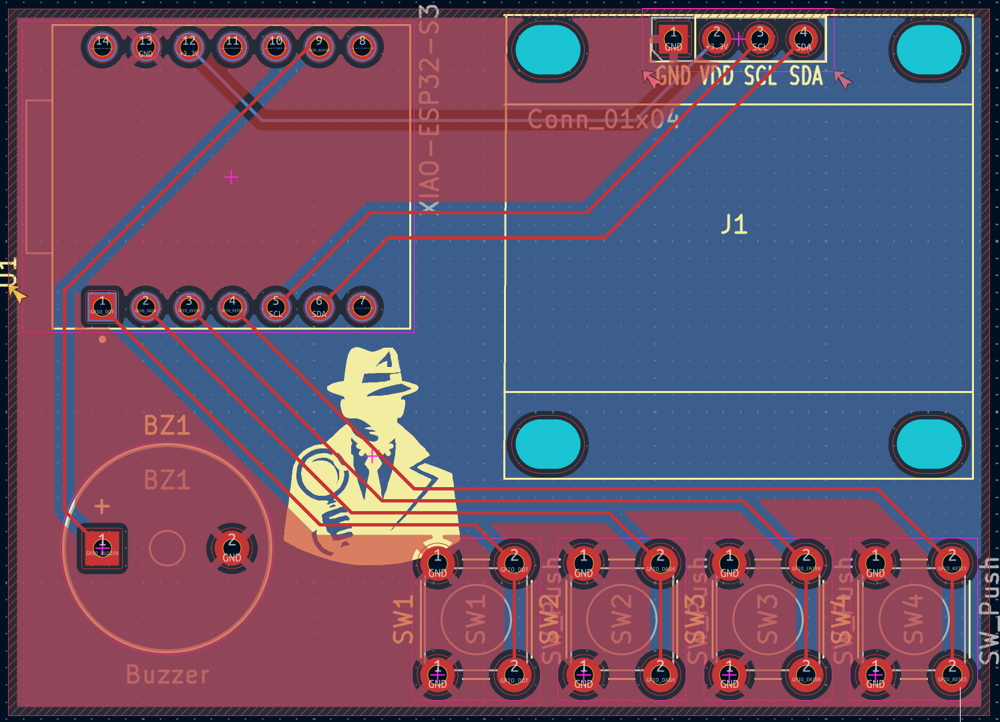
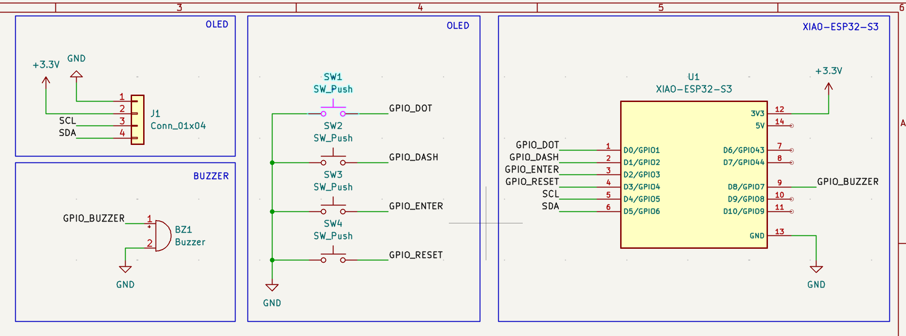

# Morse-Code-PCB-Practice-
custom pcb design for a pocket-sized morse code trainer powered by a seeed studio xiao esp32-s3 microcontroller, featuring an i2c oled display, tactile buttons, and an onboard buzzer.

Pocket Morse Code Trainer

A custom-designed, pocket-sized Morse Code training device powered by a Seeed Studio XIAO ESP32-S3 microcontroller. 
It features a 0.96-inch I2C OLED display for real-time visual feedback, four tactile buttons for handling dits, dahs, enter, and reset functions, and an onboard buzzer for audio sidetone feedback.
The custom 2-layer PCB was engineered from scratch in KiCad with a full ground pour for signal integrity and an accessible USB-C port for power and firmware flashing.

Design & Layout

